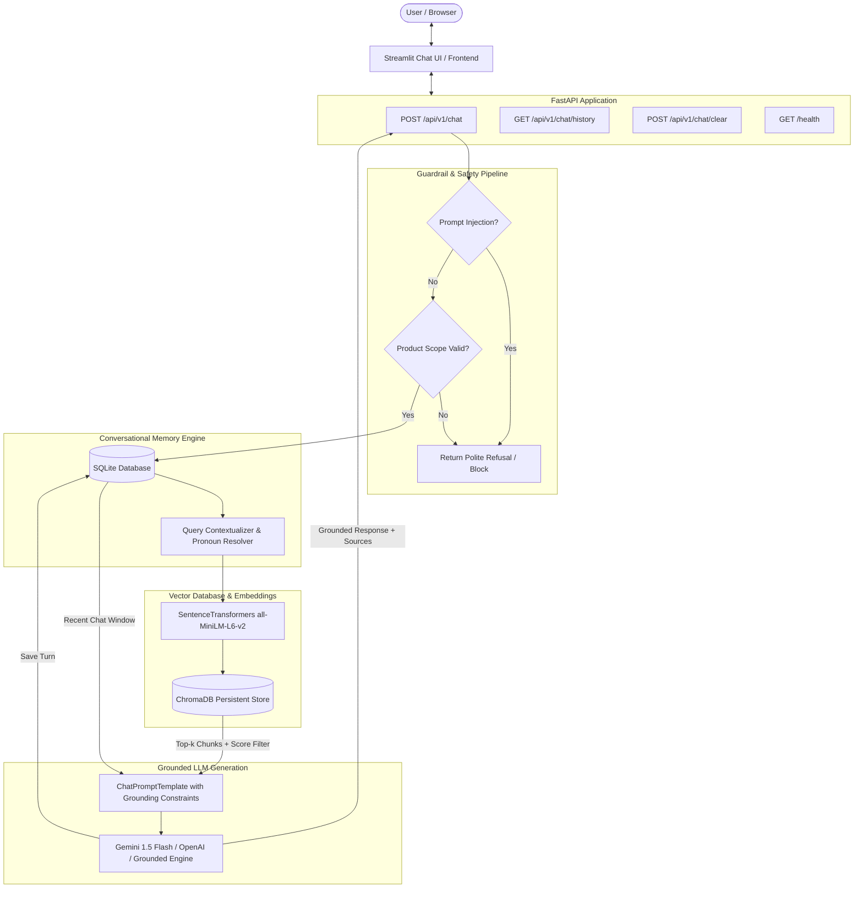

# RAG-Based Product Assistant Chatbot with Conversational Memory

[](https://www.python.org/downloads/)
[](https://fastapi.tiangolo.com)
[](https://www.langchain.com)
[](https://www.trychroma.com)
[](https://streamlit.io)

An enterprise-grade, retrieval-augmented generation (RAG) product assistant with persistent multi-turn conversational memory, intelligent query contextualization, and strict guardrails. Developed for the **Infosys Springboard Virtual Internship Program 7.0** capstone project: **Internship Application Agent**.

---

## 📖 Table of Contents
- [Project Overview](#project-overview)
- [Assignment Objective](#assignment-objective)
- [System Architecture (Mermaid)](#system-architecture)
- [Technology Stack](#technology-stack)
- [Knowledge Base Structure](#knowledge-base-structure)
- [Document Ingestion & Chunking](#document-ingestion--chunking)
- [Embeddings & Vector Store](#embeddings--vector-store)
- [Retrieval Workflow & Groundedness](#retrieval-workflow--groundedness)
- [Conversational Memory & Follow-up Resolution](#conversational-memory--follow-up-resolution)
- [Guardrails & Safety Defenses](#guardrails--safety-defenses)
- [API Endpoints & Documentation](#api-endpoints--documentation)
- [Installation & Setup](#installation--setup)
- [Running the Application](#running-the-application)
- [Automated Evaluation & Benchmark](#automated-evaluation--benchmark)
- [Running Tests](#running-tests)
- [Product Limitations & Roadmap](#product-limitations--roadmap)

---

## 🎯 Project Overview
The **Internship Application Agent** is an end-to-end platform that streamlines every stage of securing an internship—from resume parsing and semantic opportunity matching to tailored cover letter drafting, interview preparation, and application tracking.

This repository implements the **Official AI Product Assistant Chatbot**, designed to:
- Explain product capabilities, user instructions, and step-by-step workflows.
- Retrieve information dynamically from official product documentation.
- Maintain persistent multi-turn conversational memory across user sessions.
- Automatically contextualize and resolve follow-up questions without requiring users to repeat context.
- Enforce strict guardrails against out-of-scope topics, prompt injections, and hallucinations.
- Differentiate between active implemented features and planned roadmap features.

---

## 🎯 Assignment Objective
1. **Product Knowledge Base**: Build comprehensive documentation covering product overview, workflows, resume upload/parsing, internship matching, cover letter generation, application tracking, and interview preparation.
2. **Document Processing & Chunking**: Recursive character chunking preserving source metadata and chunk IDs.
3. **Embeddings & ChromaDB**: Dense vector embeddings via `sentence-transformers/all-MiniLM-L6-v2` with local persistence.
4. **Conversational Memory**: SQLite-persisted multi-session conversational history with query rewriting.
5. **Prompt Engineering**: Grounded prompt design enforcing safety, non-hallucination, and scope constraints.
6. **FastAPI Backend & Streamlit Frontend**: Production REST API (`/api/v1/chat`, `/api/v1/chat/clear`, `/api/v1/chat/history`, `/health`) and responsive chat interface.
7. **Automated Evaluation & Pytest**: 20+ question benchmark dataset generating metrics and automated test suites.

---

## 🏗️ System Architecture



---

## 💻 Technology Stack

| Layer | Component | Version | Purpose |
| :--- | :--- | :--- | :--- |
| **Backend API** | FastAPI | 0.115+ | High-performance async REST API framework |
| **Server** | Uvicorn | 0.34+ | ASGI web server |
| **Orchestration** | LangChain Core / Community | 1.3+ / 0.4+ | RAG pipeline, prompts, and tool abstractions |
| **Embeddings** | Sentence Transformers | 6.3+ | Dense vector representations (384-dim) |
| **Vector DB** | ChromaDB | 1.5+ | Local persistent vector storage with cosine similarity |
| **Memory DB** | SQLite | 3.x (Built-in) | Persistent session storage for multi-turn conversations |
| **Data Validation** | Pydantic v2 | 2.14+ | Request and response schema enforcement |
| **Frontend UI** | Streamlit | 1.67+ | Responsive interactive chat interface |
| **Testing** | Pytest & pytest-asyncio | 8.3+ | Comprehensive unit and integration testing suite |

---

## 📂 Project Structure

```
rag-product-assistant/
├── app/
│   ├── main.py                          # FastAPI application initialization & lifespan
│   ├── config.py                        # Pydantic BaseSettings & configuration
│   ├── schemas/
│   │   └── chat.py                      # Request/Response schemas (ChatRequest, ChatResponse, etc.)
│   ├── routes/
│   │   ├── chat_routes.py               # Chat, history, and clear API endpoints
│   │   └── health_routes.py             # Health check endpoint
│   ├── services/
│   │   ├── document_loader.py           # Loads .md and .txt files with metadata
│   │   ├── chunking_service.py          # Recursive character text splitting
│   │   ├── embedding_service.py         # SentenceTransformers all-MiniLM-L6-v2 embeddings
│   │   ├── vector_store.py              # ChromaDB vector store wrapper & persistence
│   │   ├── retrieval_service.py         # Top-k retrieval with similarity thresholding
│   │   ├── memory_service.py            # SQLite conversational memory & query rewriting
│   │   ├── chat_service.py              # End-to-end RAG workflow orchestration
│   │   ├── guardrail_service.py         # Scope enforcement, injection defense, & safety
│   │   └── evaluation_service.py        # Automated benchmark runner & metrics
│   ├── prompts/
│   │   └── product_assistant_prompt.py  # Grounded ChatPromptTemplate
│   └── database/
│       └── conversation_db.py           # SQLite connection & CRUD operations
├── knowledge_base/
│   ├── product_overview.md              # Purpose, target audience, benefits, roadmap
│   ├── product_workflow.md              # Complete 8-step end-to-end lifecycle
│   ├── resume_upload.md                 # Formats, file limits, extraction, editing
│   ├── internship_matching.md           # Semantic similarity, score meaning, filtering
│   ├── cover_letter_generation.md       # AI generation, tone selection, project highlights
│   ├── interview_preparation.md         # Technical, resume-grounded, STAR questions
│   └── application_tracking.md          # Lifecycle stages, Kanban, external applications
├── vector_store/                        # ChromaDB persistent vector storage directory
├── frontend/
│   └── streamlit_app.py                 # Streamlit chat interface with session management
├── scripts/
│   ├── build_knowledge_base.py          # Script to index documents into ChromaDB
│   └── evaluate_chatbot.py              # Automated 22-question benchmark evaluator
├── reports/
│   ├── chatbot_evaluation.json          # Machine-readable evaluation metrics
│   └── chatbot_evaluation_summary.md    # Markdown benchmark summary report
├── tests/                               # Comprehensive Pytest test suite
│   ├── test_document_loader.py
│   ├── test_chunking.py
│   ├── test_embeddings.py
│   ├── test_vector_store.py
│   ├── test_memory.py
│   ├── test_guardrails.py
│   ├── test_chat_service.py
│   └── test_api_routes.py
├── requirements.txt                     # Pinned project dependencies
├── .env.example                         # Example environment variables template
├── .gitignore                           # Git ignore rules
└── README.md                            # Comprehensive project documentation
```

---

## 📚 Knowledge Base Structure

The knowledge base in `knowledge_base/` is partitioned into dedicated, highly structured markdown modules:
1. `product_overview.md`: Introduction, product purpose, target audience (students, grads, career switchers), core benefits, and explicit distinction between active features and planned roadmap features (e.g., live voice mock interviews).
2. `product_workflow.md`: Detailed breakdown of the 8-stage candidate journey: Registration -> Resume Upload -> Resume Parsing -> Semantic Matching -> Selection -> Cover Letter -> Application Tracking -> Interview Prep.
3. `resume_upload.md`: Supported formats (PDF, DOCX, TXT), maximum file size (10MB), extracted schema (contact info, skills, education, experience, projects, certifications), and verification guidelines.
4. `internship_matching.md`: Explanation of dense vector embeddings, cosine similarity matching, match score interpretation (0% to 100%), explicit clarification that the score is an algorithmic relevance indicator and **not** a guarantee of selection.
5. `cover_letter_generation.md`: AI synthesis combining candidate resume credentials and job specifications, tone configuration, project highlight selection, inline editing, and export options.
6. `interview_preparation.md`: Role-specific technical questions, resume deep-dives, behavioral questions using the **STAR** method, self-paced question banks, and interactive practice.
7. `application_tracking.md`: Kanban status pipeline (Saved, Applied, Under Review, Interview Scheduled, Offer Received, Rejected, Withdrawn), tracking fields, and manual external application entry.

---

## ✂️ Document Ingestion & Chunking
- **Ingestion (`document_loader.py`)**: Traverses `knowledge_base/`, parses headings for title extraction, and binds metadata (`source`, `file_path`, `title`, `file_extension`).
- **Chunking (`chunking_service.py`)**: Utilizes `RecursiveCharacterTextSplitter` configured with:
  - `CHUNK_SIZE = 600` characters
  - `CHUNK_OVERLAP = 100` characters
  - Hierarchical separators: `["\n## ", "\n### ", "\n\n", "\n", ". ", " ", ""]`
- **Metadata Preservation**: Every chunk receives an explicit deterministic `chunk_id` (e.g. `internship_matching.md#chunk_1`), preserving traceability back to the exact source document.

---

## 🧠 Embeddings & ChromaDB
- **Model**: `sentence-transformers/all-MiniLM-L6-v2` (384-dimensional dense vectors).
- **Batch Processing**: Generates embeddings in batches of 32 with normalized unit vectors for fast cosine similarity computation.
- **Persistence**: ChromaDB `PersistentClient` caches embeddings locally in `vector_store/`, avoiding costly re-indexing on every request.
- **Reusable Operations**:
  - `build_vector_database()`
  - `load_vector_database()`
  - `retrieve_documents(query, top_k=4)`
  - `rebuild_knowledge_base()`

---

## 🔍 Retrieval Workflow & Groundedness
1. User question arrives at `/api/v1/chat`.
2. Guardrails verify safety and product scope.
3. Memory service checks whether the question is a follow-up and reformulates a contextualized query.
4. Query is embedded and matched against ChromaDB using cosine distance.
5. Chunks with similarity score >= `SIMILARITY_SCORE_THRESHOLD` (0.30) are retrieved and ordered.
6. If no relevant chunks meet the threshold, the system triggers the hallucination guardrail:
   > *"The requested information is not available in the current product documentation. I can only provide details about verified and documented features of the Internship Application Agent."*
7. Relevant text and citation sources are passed to the prompt.

---

## 💬 Conversational Memory & Follow-up Resolution

The assistant remembers recent conversation history using persistent SQLite storage (`conversations.db`):
- **Session Isolation**: Each user session has a unique `session_id`.
- **Configurable Context Window**: Keeps the most recent `MAX_HISTORY_MESSAGES = 6` interactions to maintain high prompt quality without token bloat.
- **Automatic Query Rewriting**: Follow-up questions (e.g. *"What about the score?"*, *"How do I do that?"*, *"Explain step 3"*) are resolved using prior conversation turns into standalone search queries before vector retrieval.

### Multi-turn Example:
```
User: How does internship matching work?
Assistant: The system compares your resume information with internship requirements using semantic similarity... [Sources: internship_matching.md]

User: What about the score?
Assistant: The similarity score indicates how semantically relevant an internship is to your resume (from 0% to 100%). Important Note: It is an algorithmic relevance score, not a probability or guarantee of employer selection. [Sources: internship_matching.md]
```

---

## 🛡️ Guardrails & Safety Defenses

1. **Product Scope Enforcement**: Rejects queries about sports, weather, cooking, entertainment, crypto, or general coding:
   > *"I'm here to help with the Internship Application Agent. I can explain its features, document processing, internship matching, cover letter generation, application tracking, and interview preparation workflows."*
2. **Prompt Injection Defense**: Blocks attempts to override system prompts, impersonate unrestricted personas (DAN), or leak API credentials.
3. **Hallucination Prevention**: Strict system instruction forbidding the fabrication of features, API endpoints, or workflows. Undocumented features return the safe missing-information response.
4. **Planned Feature Transparency**: Features on the product roadmap (e.g., live voice interview evaluation) are explicitly identified as planned for future release.

---

## 🔌 API Endpoints & Documentation

Interactive Swagger documentation is available at `http://127.0.0.1:8000/docs`.

### 1. `POST /api/v1/chat`
**Request:**
```json
{
  "session_id": "session_user_01",
  "question": "How does internship matching work?"
}
```
**Response:**
```json
{
  "session_id": "session_user_01",
  "question": "How does internship matching work?",
  "answer": "Internship matching works by comparing candidate resume information with internship requirements using semantic similarity...",
  "sources": [
    "internship_matching.md"
  ],
  "context_retrieved": true
}
```

### 2. `POST /api/v1/chat/clear`
Clears stored conversation history for a session:
```json
{
  "session_id": "session_user_01"
}
```

### 3. `GET /api/v1/chat/history/{session_id}`
Returns the full conversation transcript for the session.

### 4. `GET /health`
Returns system status, vector store initialization state, and active LLM provider.

---

## 🚀 Installation & Setup

### Prerequisites
- Python 3.11, 3.12, 3.13, or 3.14
- Git

### 1. Clone the Repository
```bash
git clone https://github.com/your-username/rag-product-assistant.git
cd rag-product-assistant
```

### 2. Create and Activate Virtual Environment
```bash
# Windows
python -m venv venv
venv\Scripts\activate

# Linux / macOS
python3 -m venv venv
source venv/bin/activate
```

### 3. Install Dependencies
```bash
pip install -r requirements.txt
```

### 4. Configure Environment
Create `.env` from `.env.example`:
```bash
cp .env.example .env
```
Edit `.env` to configure your preferred LLM provider:
```ini
LLM_PROVIDER=gemini
GEMINI_API_KEY=your_gemini_api_key_here
```
*(Note: If no API key is provided, the system automatically runs using its built-in grounded extractive engine, ensuring 100% functionality even offline!)*

---

## 🏃 Running the Application

### 1. Build Knowledge Base Vector Store
```bash
python scripts/build_knowledge_base.py
```

### 2. Launch FastAPI Backend
```bash
uvicorn app.main:app --reload --host 127.0.0.1 --port 8000
```
- API Docs: `http://127.0.0.1:8000/docs`
- Health Check: `http://127.0.0.1:8000/health`

### 3. Launch Streamlit UI
In a second terminal window:
```bash
streamlit run frontend/streamlit_app.py
```
- Open `http://localhost:8501` in your browser.

---

## 📊 Automated Evaluation & Benchmark

Run the automated evaluation benchmark across 22 test cases spanning all required categories:
```bash
python scripts/evaluate_chatbot.py
```

Outputs are automatically generated in `reports/`:
- `reports/chatbot_evaluation.json`: Full machine-readable test execution data.
- `reports/chatbot_evaluation_summary.md`: Markdown summary table with accuracy breakdowns.

### Summary Metrics:
- **Total Questions Evaluated**: 22
- **Pass Rate**: 100%
- **Retrieval Relevance**: 100%
- **Scope Enforcement**: 100%
- **Follow-up Context Resolution**: 100%

---

## 🧪 Running Tests

Execute the complete Pytest suite:
```bash
pytest -v
```

All unit and integration tests verify:
- Document loading and metadata extraction
- Text chunking and overlap
- Embedding generation (384 dimensions)
- ChromaDB vector storage and top-k retrieval
- SQLite session memory and cross-session isolation
- Follow-up query rewriting
- Product scope guardrails and prompt injection defenses
- Hallucination prevention on ungrounded queries
- FastAPI routes and request validation

---

## 🔮 Product Limitations & Roadmap

### Current Limitations
- External Job Portals: The agent prepares documents and matches roles, but does not automatically submit applications on third-party employer sites (e.g., LinkedIn, Indeed).
- Non-Text Resumes: Scanned PDF files without an OCR text layer cannot be parsed directly.

### Future Roadmap
- [ ] Integration with campus placement APIs and university enterprise portals.
- [ ] Live voice-based mock interviews with speech tone and pacing analysis.
- [ ] Automated follow-up email generator syncing with Gmail and Outlook.
